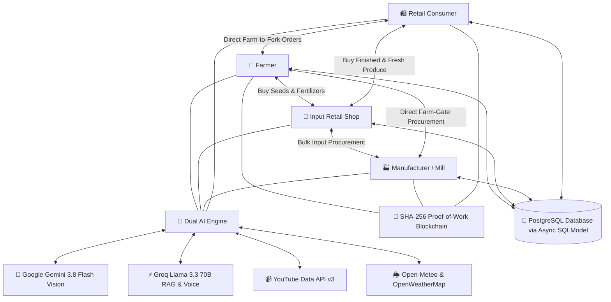
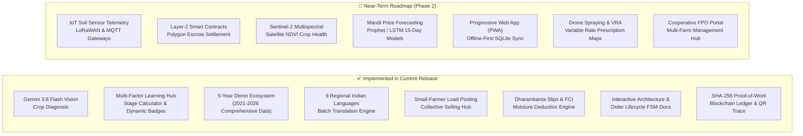

# 🌾 AgriFlow.AI: Project Features, Architecture & Implementation Roadmap

> **Comprehensive Technical Specification & Feature Roadmap**  
> *A unified, multi-role agricultural supply chain, agronomic intelligence, and cryptographic provenance platform.*

---

## 🏗️ 1. System Architecture & Ecosystem Connectivity

AgriFlow.AI connects four vital agricultural stakeholders — **Farmers**, **Input & Fertilizer Retailers**, **Grain Processing Mills / Manufacturers**, and **Retail Consumers** — into a unified, cryptographically auditable, and AI-driven supply chain ecosystem.

### Role Interaction & Telemetry Map

---

## 🌟 2. 5-Year Comprehensive Demo Ecosystem (2021 – 2026)

The platform comes pre-packaged with an authentic, multi-year dataset spanning **2021 through 2026** across all 4 roles. Stakeholders and reviewers can launch any role with **1-click** from the interactive top-navigation **"5-Yr Demo"** button:

| Role | Profile & Location | Demo Credentials | 5-Year Dataset Highlights (2021 – 2026) |
| :--- | :--- | :--- | :--- |
| 🌾 **Farmer** | **Ravi Kumar Reddy** Krishna District, Andhra Pradesh | `demo@farmer.com` `demo123` | • **14 Seasonal Crop Cycles** (Paddy, Cotton, Maize, Wheat, Tomato, Moong) • **₹18.5L+ Cumulative Turnover** with seasonal mandi & mill sales records • **SBI Kisan Credit Card (KCC)** & PACS cooperative loan repayment ledgers • **PMFBY / WBCIS Insurance** with settled flood/drought claim records • **3 Biennial Soil Health Cards** (2021, 2023, 2025) & e-NWR warehouse storage |
| 🏪 **Shop Owner** | **Krishna Agro Center** Venkat Rao Potti | `demo@shop.com` `demo123` | • **134+ Orders** across 2021–2026 (Completed, Dispatched, Confirmed, Pending) • **15 Agricultural Input Products** (Seeds, Fertilizers, Bio-nutrients, Sprays) • **60 Continuous Months (5 Years)** of categorized accounting P&L ledgers • Real-time POS checkout with automatic inventory decrement upon confirmation |
| 🏭 **Mill Owner** | **Sri Venkateswara Mill** Prasad Babu Reddy | `demo@manufacturer.com` `demo123` | • **120 Ton/Day Capacity** Rice & Flour Milling Industrial Plant • **11 Farm-Gate Procurements** (310+ Quintals Paddy & Wheat intake) • **60+ Industrial Milling Batches** & By-Product Recovery (Bran, Husk, DOC) • **210 Factory Expense Entries** & Wholesale B2B Distribution Sales Orders |
| 🛍️ **Customer** | **Priya Sharma** Direct Farm Consumer | `demo@customer.com` `demo123` | • **45+ Consumer Orders (2021–2026)** of fresh produce & packaged staples • Full order history tracking with downloadable GST tax invoices • Multi-item cart checkout with integrated Razorpay payment verification |

---

## 🔐 3. Identity, Multi-Role & Access Management

AgriFlow.AI provides a flexible, secure authentication system designed to accommodate agricultural users who wear multiple professional hats.

#### **A. Multi-Credential Authentication**
1. **Dual Login Methods**: Register and authenticate using either a verified **Email Address** or an Indian **Phone Number** (`+91`).
2. **OTP Verification**: Integrated **Phone OTP (SMS)** via Fast2SMS and **Email OTP** via Brevo HTTP API (Port 443 HTTPS for cloud reliability) with direct Gmail SMTP fallback.
3. **Cryptographic Security**: Industry-standard **Bcrypt / Passlib Password Hashing** and **HS256 JWT (JSON Web Token)** based session security.
4. **Interactive Security Controls**: Embedded password show/hide visibility toggles across all auth, registration, and profile forms.
5. **Zero-Scroll Single Page Experience**: Responsive authentication viewports tailored for mobile and desktop screens.

#### **B. Multi-Role Account Logic (Same-Credential Multi-Role)**
1. **Credential Versatility**: A single individual can maintain distinct professional profiles (e.g. a **Farmer** who also operates an **Agri-Input Shop**) using the exact same Email or Phone Number.
2. **Role Isolation**: The system partitions each `(Credential + Role)` pair into an isolated account entity:
   - Farm cultivation logs, inventory stock, milling batches, and shopping carts remain completely segregated.
   - Role-specific dashboards and accounting analytics never overlap.
   - Users switch between professional roles instantly by selecting the desired role upon login.

---

## 👥 4. Role-Based Feature Suite

---

### 🚜 1. Farmer Role (22 Modules)

The farmer's experience is an end-to-end farm management and agronomic intelligence operating system.

#### **A. Central Dashboard (Command Center)**
1. **Identity & Land Portfolio**:
   - Farmer profile details (Farmer ID, Guardian name, Bank IFSC & Account, Irrigation methods).
   - Detailed landholdings registered in **Acres.Guntas** (Base-40 logic) with Khasra/Survey serial numbers.
2. **Farm Work Calendar**:
   - Monthly interactive activity scheduler (Sowing, Top-dressing, Irrigation, Spraying, Harvesting).
   - "Days Left" countdown reminders for upcoming critical milestones.
3. **Quick Insights & Live Alerts**:
   - Active crops feed showing only currently growing seasonal cycles.
   - Filtered mandi market prices matched specifically to the farmer's active crops.
   - Instant micro-climate weather, soil root-zone moisture, and regional agricultural news summaries.

#### **B. Crop Lifecycle & Detailed Field Operations**
1. **Financial & Cost Tracking**: Itemized logging of seed purchase, fertilizer, pesticide, machinery/tractor hours, irrigation power, and labor man-days.
2. **Operations Log**: Complete historical diary of field interventions from land preparation to post-harvest threshing.
3. **Harvest & Direct Sales**: Recording of harvested bags/quintals with quality grading (Grade A, B, C) and 1-click sales routing to Mandis, Mills, or direct Consumers.
4. **Cryptographic Harvest QR**: Generates unique verifiable QR codes linking harvested batches to immutable origin data.

#### **C. Context-Aware Learning Hub & Dynamic Recommendation Engine**
1. **Multi-Factor Input Telemetry**:
   - **Weather & 7-Day Forecast**: Current temperature, rain probability, extreme alerts (heatwave > 38°C, heavy rainfall > 15mm).
   - **Crops & Mathematical Growth Stage**: Dynamic estimation using sowing and harvest timeline calculations.
   - **Soil Profile & Plot Chemistry**: Integrates plot soil textures (Black, Alluvial, Red, Sandy Loam) and N-P-K nutrient status.
   - **Crop Health & Disease Logs**: Feeds active pathologies, leaf blight alerts, and pest damage states.
2. **Key Design Decisions**:
   - **Decision 1: Server-Side Context Aggregation with Client Override Option**:
     - *Choice*: The backend `/learning/videos` and `/learning/context` endpoints autonomously assemble the authenticated farmer's `Crop`, `SoilProfile`, `CropHealthStatus`, and cached `Weather` data directly from PostgreSQL and internal services.
     - *Why*: Keeps the frontend lightweight and secure. The UI simply requests recommendations without shipping heavy telemetry payloads.
     - *Fallback*: Optional client query parameters (`crop_names`, `soil_type`, `weather_alert`) allow instant testing and manual overrides.
   - **Decision 2: Contextual Stage Calculator**:
     - *Formula*:
       $$\text{Progress } \% = \frac{\text{Current Date} - \text{Sowing Date}}{\text{Harvest Date} - \text{Sowing Date}} \times 100$$
     - *5 Growth Stages*:
       - **0% – 20%**: *Sowing & Seedling* (Germination, initial root development, seed treatment)
       - **21% – 50%**: *Vegetative Growth* (Tillering, branch growth, nitrogen boost, weed control)
       - **51% – 75%**: *Flowering & Reproductive* (Panicle initiation, boll formation, micronutrients, pest defense)
       - **76% – 100%**: *Grain Filling & Pre-Harvest* (Moisture control, ripening, harvest preparation)
       - **> 100%**: *Harvest & Storage* (Threshing, moisture testing, grain storage, mandi sales)
   - **Decision 3: Dynamic Category Prioritization & Reason Badges**:
     - Categories dynamically reorder based on real-time field urgency:
       - 🚨 **Priority #1 — Crop Health Emergency**: Active pathology detected $\rightarrow$ Category #1 becomes *Crop Health Emergency* (e.g. *Cotton Pink Bollworm Control*).
       - 🌦️ **Priority #2 — Weather Advisory**: Rain $> 15\text{mm}$ or temperature $> 38^\circ\text{C}$ $\rightarrow$ Category #2 becomes *Weather Advisory*.
       - 🌱 **Priority #3 — Stage-Specific Guide**: Aligned with the active crop's mathematical growth stage.
       - 🧪 **Priority #4 — Soil Management**: Specific to the plot's soil texture (Black, Alluvial, Red) and N-P-K balance.
       - 📚 **Standard Modules**: Nutrient planning, mandi intelligence, government welfare schemes, modern smart tech.

#### **D. AI Crop Health Diagnosis (Google Gemini 3.8 Flash Vision)**
1. **Multimodal Leaf Pathology Diagnosis**: Instant disease identification from mobile leaf photos using Google Gemini 3.8 Flash Vision (`backend/app/routers/crop_health.py`).
2. **Structured Treatment Recommendations**: Returns disease name, confidence %, severity rating, detailed symptom description, affected plant parts, step-by-step treatment schedule, chemical & organic pesticide recommendations with exact dosages, and cultural prevention tips.
3. **4-Tier Fallback Chain**:
   $$\text{Gemini 3.8 Flash Vision} \longrightarrow \text{Structured JSON parse} \longrightarrow \text{Regex JSON extraction} \longrightarrow \text{Simulated diagnosis fallback}$$
4. **Persistent History**: All diagnostic runs saved to `crop_diagnoses` linked to specific crops for long-term health tracking.

#### **E. Soil Health Card (SHC) & ICAR Fertility Scoring**
1. **Laboratory Soil Health Card**: Records available Nitrogen (N), Phosphorus (P), Potassium (K) in kg/ha, pH reaction, Organic Carbon %, Electrical Conductivity (EC), and micronutrients (Zn, Fe, S, B in ppm).
2. **ICAR Benchmark Fertility Scoring**: Computes an automated fertility score (0–100) with status ratings (Optimal, Moderate, Needs Attention), agronomist reclamation guidance, and overdue retest warnings (> 2 years).

#### **F. Plot Nutrition & Fertilizer Schedule Optimizer**
1. **N-P-K Radar Chart Profiling**: Visual radar chart comparing soil nutrient levels against target crop thresholds.
2. **Fertilizer Deficit Calculation**: Computes exact kg requirements for standard Indian fertilizers: Urea (46% N), DAP (18-46-0), and MOP (60% K₂O).
3. **Split-Dosage Application Schedule**: Divides fertilizer application across Basal Dressing, First Top-Dressing, and Flowering Boost stages.

#### **G. Meteorological Telemetry & Agro-Advisory (Open-Meteo Integration)**
1. **5-Layer Volumetric Soil Moisture**: Live root-depth water content telemetry across 0–1cm (surface), 1–3cm (seedling roots), 3–9cm (active feeding zone), 9–27cm (taproot zone), and 27–81cm (subsoil reserve).
2. **7-Day Agricultural Forecast**: Daily high/low temperature, precipitation volume (mm), relative humidity, wind speed, and reference crop evapotranspiration (ET₀ mm).
3. **Smart Spray Advisories**: Real-time evaluation of safe pesticide spraying hours based on wind speed, precipitation probability, and leaf wetness.

#### **H. Mill Direct Selling, Fair Deductions & Collective Load Pooling**
1. **Mill Marketplace & Direct Harvest Offers**: Dispatch harvest offers to nearby processing mills with quantity (Quintals), moisture content (%), expected price, delivery slot (`Morning`, `Afternoon`, `Evening`), and transport vehicle (`Tractor`, `Mini Truck`, `10-Wheeler`).
2. **Fair Moisture & Weighbridge Deduction Calculator**:
   - Scientific Government FCI standard moisture deduction formula:
     $$W_{\text{standard}} = W_{\text{actual}} \times \frac{100 - M_{\text{actual}}}{100 - M_{\text{standard}}}$$
   - Benchmark moisture standards: Paddy (17%), Wheat (12%), Maize (14%), Soybeans (12%).
   - Interactive sliders calculating deduction weight, net payable weight, and fair price comparisons protecting farmers against arbitrary broker cuts.
3. **Digital Gate Pass & Encrypted QR Token**: Sequential token issuance (`TK-YYYYMMDD-XXXX`) with tamper-proof SVG QR gate passes for priority mill entry.
4. **Small-Farmer Collective Selling (Load Pooling Hub)**: Peer-to-peer load aggregation portal (`/dashboard/farmer/mills/load-pools`) aggregating small 10–25 quintal harvests into full commercial 100–150 quintal truckloads for bulk premium procurement.

#### **I. Farm Financials, Institutional Credit & Risk Protection**
1. **Institutional Credit & Loan Tracker**: Multi-source tracking across Bank Kisan Credit Cards (KCC), Fertilizer Shop Credits, Cooperative Societies (PACS), and Traders, monitoring principal amounts, interest rates, and repayment due dates.
2. **Repayment Ledger**: Log digital/cash partial and full repayments with automatic balance adjustments and interest accumulation.
3. **PMFBY Crop Insurance & 72-Hour Calamity Claim**: Registry for Pradhan Mantri Fasal Bima Yojana (PMFBY), weather-index insurance, and commercial policies with end-to-end claim filing workflow and emergency 72-hour reporting hotlines (`14447`).
4. **Produce Storage & e-NWR Cold Storage Tracker**: Post-harvest warehouse and cold storage tracking with dynamic monthly rent calculations and mandi peak price release alerts.
5. **ReportLab Official PDF Export**: Generate bank-ready formal financial statement PDFs for KCC renewals, equipment loans, and subsidy verifications.

#### **J. Multi-Season Performance Audit & Analytics**
1. **Season Performance Comparison**: Side-by-side comparative analysis of Kharif, Rabi, and Zaid seasons across cost, yield, gross revenue, net profit, and profit margins.
2. **Annual Financial Audit Ledger**: Multi-year financial ledger computing Year-over-Year (YoY) revenue, expenditure, and net income trajectories.
3. **Ranked Crop Profitability League**: Visual ranking (🥇 #1, 🥈 #2, 🥉 #3) based on Cost-Benefit Ratio (CBR) and net profit per acre.

#### **K. Emergency SOS Directory**
1. **Priority 3-Box SOS Banner**: Direct-dial emergency hotlines: Kisan Call Center (`1551`), PMFBY Calamity Line (`14447`), and Rural Electricity Breakdown (`1912`).
2. **Categorized Agricultural Directory**: National helplines, KVK agronomists, mobile veterinary units (`1962`), canal irrigation engineers, and personal technician contacts.

#### **L. Fertilizer & Input Marketplace (50km Geofence)**
1. **50km Radius Procurement**: Browse verified fertilizers, pesticides, seeds, and machinery within a 50km radius of the farm's GPS location.
2. **Multi-Shop Shopping Cart**: Unified cart supporting orders from multiple local retailers with Razorpay online and Cash on Delivery (COD) payment options.

---

### 🏪 2. Shop Role (Input Retail & Merchant Accounting — 8 Modules)

The shop owner's journey is a comprehensive retail inventory, customer khata, and financial accounting platform.

| Module | Feature Capabilities |
| :--- | :--- |
| 📦 **Inventory & Batch Tracking** | Product catalog spanning seeds, fertilizers, and crop protection inputs. Draft $\rightarrow$ Active pipeline, batch-wise cost pricing, manufacture dates, and automatic inventory decrement upon order confirmation. |
| 🔄 **Order Lifecycle FSM** | Strict state machine (`pending` $\rightarrow$ `confirmed` $\rightarrow$ `dispatched` $\rightarrow$ `completed`, or `cancelled` / `rejected`) synchronized between farmer and shop dashboards. |
| ⚙️ **Shop Auto-Confirm Engine** | 3 modes: `manual` (review every order), `auto_all` (instant confirmation), `auto_selected` (trusted regular farmers whitelist). Features a `low_stock_buffer` safeguard overriding auto-confirm if stock falls below threshold. |
| 💳 **Omnichannel POS Counter** | Rapid walk-in sales side-panel cart supporting cash, credit khata, and digital UPI transactions with customer ledger entries. |
| 📊 **60-Month Accounting Ledger** | Continuous multi-year P&L accounting tracking rent, payroll, electricity, batch transport, and unloading labour with weighted cost distribution across batches. |
| 📈 **Sales Analytics & Margin Insights** | Real-time category breakdown across Seeds, Fertilizers, Pesticides, and Machinery, batch-wise profitability, and Cash vs Online channel metrics. |
| 📅 **Regional Crop Calendar Tracker** | Track upcoming regional sowing seasons to anticipate demand spikes and prevent inventory stockouts. |
| 👤 **Profile, Licenses & Payouts** | Manage shop registration, pesticide/fertilizer retail licenses, physical address geofencing, and Bank / UPI settlement accounts. |

---

### 🏭 3. Manufacturer / Mill Role (Industrial Production & Procurement — 7 Modules)

Designed for industrial processing plants (Rice Mills, Flour Mills, Oil Extraction) bridging the gap between raw harvest and branded retail products.

| Module | Feature Capabilities |
| :--- | :--- |
| 🚛 **Farm-Gate Procurement Queue** | Inbound farmer harvest offer triage with moisture inspection (%), offered prices, delivery slot scheduling, sequential token generation (`TK-YYYYMMDD-XXXX`), and encrypted digital gate passes. |
| ⚖️ **Dharamkanta Digital Weighment Slip** | Formal weighbridge slip recording Gross Truck Weight (laden) and Tare Weight (unladen), itemized FCI moisture cuts, Net Payable Weight, live MSP benchmarking, and printable official receipts. |
| 🏭 **Industrial Milling Runs & Yield** | Primary processing conversion transforming raw grain batches into finished branded packaged goods (SV Supreme Atta, SV Sharbati Rice) with yield analysis. |
| ♻️ **By-Product Inventory & Recovery** | Dedicated tracking of secondary milling outputs: Rice Bran, Rice Husk, Broken Rice, Mustard DOC, Wheat Choker. In-stock valuation, wholesale price tracking, and B2B buyer sales logging (`PATCH /manufacturer/by-products/{id}`) with automated stock relief. |
| 💰 **Factory Overhead Accounting** | 5-year operational expense ledger tracking machinery maintenance, industrial power tariffs, labor wages, packaging materials, and bulk logistics. |
| 📦 **Wholesale B2B Sales Pipeline** | Bulk product distribution to retail shops and institutional distributors with order status pipeline management. |
| 📈 **Procurement & Milling Analytics** | "When to Buy" procurement intelligence based on regional harvest forecasts, top crop purchase averages, and production cost-per-kg calculations. |

---

### 🛍️ 4. Customer Role (End Consumer Marketplace — 5 Modules)

Providing a transparent, farm-to-table shopping experience with verified origin and quality certification.

| Module | Feature Capabilities |
| :--- | :--- |
| 🛒 **Smart Farm-to-Fork Marketplace** | Curated catalog of fresh farm produce and mill-packaged goods with transparent farmer pricing, organic certifications, and low-stock indicators. |
| 🔗 **Public Blockchain Provenance** | Scan retail produce QR codes (`/trace/[id]`) to view the immutable seed-to-shelf journey timeline from farmer planting to processing and supermarket delivery. |
| 🛍️ **Multi-Item Cart & Razorpay Checkout** | Persistent cart across sessions with integrated Razorpay modal supporting UPI, Google Pay, NetBanking, and Credit/Debit Cards with HMAC signature verification. |
| 📋 **Order History & GST Tax Invoices** | Historical order tracking accordion, live status timeline, itemized receipts, and downloadable formal GST tax invoices. |
| 💡 **Smart Buying Advisory** | Price-trend analytics advising consumers on optimal seasonal buying windows to purchase commodities at peak quality and lowest market rates. |

---

## 🤖 5. Cross-Role AI & Intelligence Infrastructure

### A. Dual AI Engine Architecture
AgriFlow.AI deploys specialized AI models matched to specific tasks:
1. **Google Gemini 3.8 Flash Vision**: Multimodal computer vision plant pathology diagnosis on crop leaves with structured JSON remediation and local pesticide recommendations.
2. **Groq Cloud (Llama 3.3 70B Versatile)**: Ultra-low-latency (< 200ms) conversational RAG assistant grounded in real-time localized weather, soil test results, active crop stages, and business ledgers.

### B. Hands-Free Multilingual Voice Assistant
- Interactive voice assistant powered by Web Speech API (speech recognition and synthesis) with an HTML5 Canvas live audio waveform visualizer.
- Voice-to-action capabilities allowing farmers to inquire about crop health, weather forecasts, market prices, and mandi trends without typing.

### C. 9 Regional Indian Languages (Batch Translation Engine)
- Full UI and dynamic content localization across **9 Indian Languages**:
  $$\text{English (`en`)} \quad \text{Hindi (`hi`)} \quad \text{Telugu (`te`)} \quad \text{Tamil (`ta`)} \quad \text{Kannada (`kn`)}$$
  $$\text{Marathi (`mr`)} \quad \text{Bengali (`bn`)} \quad \text{Gujarati (`gu`)} \quad \text{Punjabi (`pa`)}$$
- **Single-Call Batch JSON Translation** (`POST /api/translate`): Translates up to 50 UI strings per API call using Google Gemini 3.8 Flash with Groq fallback and in-memory MD5 key caching.

### D. Cryptographic SHA-256 Blockchain Ledger
- Custom Proof-of-Work (PoW) blockchain ledger (`backend/app/routers/blockchain.py`) providing immutable audit logs for harvest batches, organic certifications, and milling transformation hops.
- Public Block Explorer at `/dashboard/blockchain` with cryptographic chain validation (`GET /api/blockchain/verify-integrity`).

---

## 📐 6. Interactive Documentation & System Spec

AgriFlow.AI includes interactive in-app engineering documentation available directly in the web portal:

1. **Interactive System Architecture Specification (`/docs/architecture`)**:
   - **Component-Level Diagram Engine**: Interactive box-and-arrow data flow diagrams for all 22+ modules.
   - **Interactive Order Lifecycle State Machine (FSM)**: Clickable state machine inspector detailing transition triggers, stock inventory effects, and payment guards.
   - **Multi-Factor Learning Hub Architecture View**: Visual diagram matching the 4-stream telemetry pipeline and the 3 Key Architectural Decisions.
2. **API Keys & Services Directory (`/docs/api-keys`)**:
   - Live status directory for all third-party API configurations (Gemini, Groq, YouTube, Open-Meteo, Razorpay, Brevo, Fast2SMS, OpenCage).

---

## 🔮 7. Feature Status & Future Roadmap

### Detailed Roadmap Deliverables

#### **Phase 1: Current Production Release (Completed ✅)**
1. **Gemini 3.8 Flash Multimodal Vision**: Replaced deprecated/broken vision inference with native multimodal plant pathology analysis, structured JSON remediation, and a 4-tier fallback chain.
2. **Context-Aware Learning Hub**: Server-side multi-factor context aggregation, Growth Stage Estimator formula, and dynamic urgency-based category badging.
3. **Comprehensive 5-Year Demo Ecosystem**: Fully populated datasets spanning 2021–2026 across Farmer, Shop, Mill, and Customer profiles with 1-click launcher.
4. **Regional Multilingual UI**: 9-language batch translation engine with in-memory caching and dual-model failover.
5. **Dharamkanta & FCI Moisture Engine**: Scientific moisture deduction calculators protecting farmers against arbitrary broker cuts, formal printable weighment slips, and digital gate pass QR tokens.
6. **Small-Farmer Load Pooling Hub**: Peer-to-peer load aggregation portal for collective commercial truckload marketing.
7. **Interactive Architecture UI**: In-app engineering documentation at `/docs/architecture` and `/docs/api-keys`.

#### **Phase 2: Planned Upgrades (Next Horizon 🔄)**
1. **IoT Sensor & Automated Weather Station Hardware Integration**:
   - Ingest live readings from field-deployed LoRaWAN and ESP32 micro-controllers (soil volumetric moisture, electrical conductivity, canopy temperature).
   - MQTT message broker pipeline feeding directly into the farmer's plot telemetry dashboard.
2. **Layer-2 Smart Contracts & Escrow Settlements (Polygon / Base)**:
   - On-chain smart contract escrow holding buyer funds until Dharamkanta weighbridge slips and moisture inspections are digitally verified.
   - Automated payout releases directly to farmer bank accounts or digital rupee (e₹) wallets upon verified delivery.
3. **Multispectral Satellite NDVI Crop Health Monitoring**:
   - Integration with European Space Agency Sentinel-2 satellite imagery pipeline.
   - Automated Normalized Difference Vegetation Index (NDVI) and Normalized Difference Water Index (NDWI) plot contour mapping for early drought and nitrogen stress detection.
4. **AI Mandi Price Prediction Engine**:
   - Time-series machine learning models (Prophet / LSTM) forecasting 15-day forward price trajectories across 50+ regional APMC mandis.
   - Harvest timing advisory alerting farmers to hold or sell produce based on expected future price peaks.
5. **Progressive Web App (PWA) with Offline SQLite Synchronization**:
   - Offline-first field logging for remote rural regions with zero network connectivity.
   - Background service worker synchronization updating PostgreSQL records when internet connectivity is re-established.
6. **Drone Spraying Flight Plan & Variable Rate Application (VRA) Maps**:
   - Automated geo-referenced prescription shapefile exports for commercial agricultural spraying drones based on Gemini leaf disease severity maps.
7. **Cooperative FPO (Farmer Producer Organization) Management Dashboard**:
   - Administrative portal for agricultural cooperatives managing hundreds of smallholder members, collective fertilizer bulk procurement, and government subsidy distribution.

---

## 📄 License & Attribution

AgriFlow.AI is open-source software licensed under the **[MIT License](LICENSE)**.
