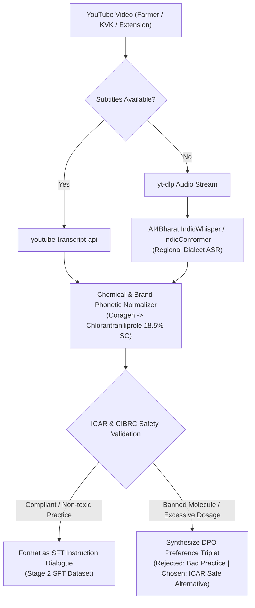
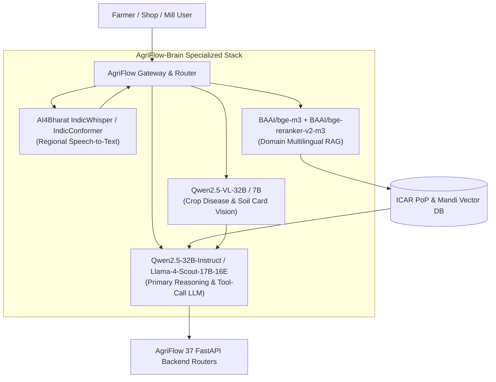
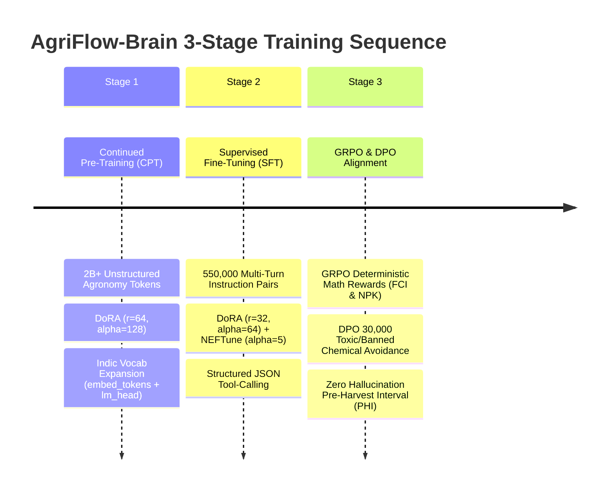
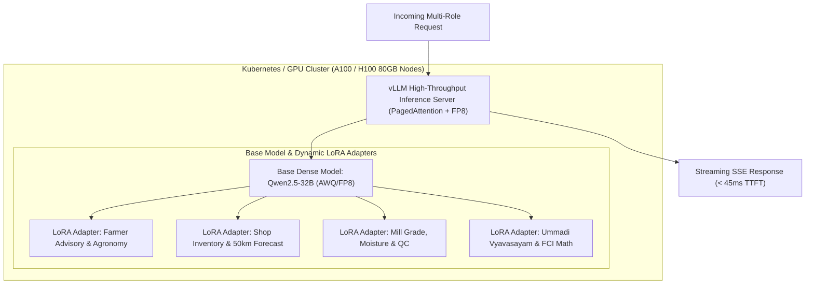

# AgriFlow-Brain: Master Model Training & Data Engineering Blueprint

> **High-Accuracy Domain-Specific Agricultural AI Model Stack**  
> *Architected for high-concurrency multi-role agricultural advisory across India (Farmers, Input Shops, Mills, and Consumers).*

---

## Executive Summary & Mission

**AgriFlow-Brain** is an end-to-end, multi-stage AI training initiative designed to build India's premier domain-adapted Agricultural Intelligence Engine. General-purpose Large Language Models (LLMs) frequently hallucinate chemical formulations, recommend banned or toxic pesticide mixtures, and fail at localized Indian agricultural math (such as FCI moisture deductions, regional land measurements like *Gunta* or *Bigha*, and NPK split applications).

AgriFlow-Brain resolves these challenges through:
1. **A 3-Pillar Data Ingestion Engine** incorporating Government APIs, ICAR Scientific Standards, and YouTube Field Wisdom.
2. **A Dual-Gatekeeper Data Pipeline** utilizing IBM Docling for scientific tables and AI4Bharat IndicWhisper with CIBRC/ICAR validation for YouTube farmer dialogues.
3. **A 3-Stage Training Methodology** combining **Continued Pre-Training (CPT)**, **DoRA + NEFTune Supervised Fine-Tuning (SFT)**, and **GRPO + DPO Safety & Mathematical Alignment**.
4. **A High-Throughput 4-Model Production Topology** served via vLLM with multi-LoRA adapters for text reasoning, vision pathology, multi-lingual RAG, and voice transcription.

```
+-----------------------------------------------------------------------------------------+
|                                    DATA ACQUISITION                                      |
|  Govt Datasets & APIs      ICAR / SAU Scientific Handbooks     YouTube Farmer & KVK Talks|
|  (data.gov.in / eNAM)        (IBM Docling Multi-column)         (AI4Bharat IndicWhisper) |
+--------------------------------------------+--------------------------------------------+
                                             |
                                             v
+-----------------------------------------------------------------------------------------+
|                               DATA PURIFICATION & GATEKEEPER                            |
|       MinHash LSH Deduplication  |  Phonetic Chemical Normalizer  |  ICAR Gatekeeper    |
|                Generates: SFT Positive Pairs  +  DPO Safety Rejected Pairs               |
+--------------------------------------------+--------------------------------------------+
                                             |
                                             v
+-----------------------------------------------------------------------------------------+
|                                 3-STAGE TRAINING REGIME                                 |
|  Stage 1: Continued Pre-Training (CPT)    -> 2B+ Tokens, DoRA (r=64), Vocab Expansion   |
|  Stage 2: Supervised Fine-Tuning (SFT)   -> 550k Pairs, DoRA (r=32) + NEFTune (alpha=5) |
|  Stage 3: GRPO Math + DPO Chemical Safety-> FCI / NPK Verification + 30k DPO Triplets    |
+--------------------------------------------+--------------------------------------------+
                                             |
                                             v
+-----------------------------------------------------------------------------------------+
|                             PRODUCTION SERVING (vLLM / FP8)                             |
|  Primary Reasoning LLM  |  Leaf & Soil Vision  |  BGE-M3 Dense RAG  |  IndicWhisper ASR  |
+-----------------------------------------------------------------------------------------+
```

---

## 1. Data Acquisition & Engineering Blueprint (The 3 Pillars)

To prevent the model from learning faulty practices or hallucinating chemical dosages, every data point passes through a deterministic extraction, verification, and transformation pipeline before entering the final training set.

| Data Pillar | Primary Sources & Endpoints | Extraction & Conversion Pipeline | Target Volume |
| :--- | :--- | :--- | :--- |
| **Pillar 1: Govt Datasets & APIs** *(Structured Ground Truth)* | • **Kisan Call Centre (KCC):** `data.gov.in` & IndiaAI AIKosh (`dackkms.gov.in` district/month CSV/JSON dumps)<br>• **AGMARKNET / eNAM:** Daily Mandi Min / Max / Modal price feeds<br>• **Soil Health Card (SHC) & PMFBY:** District NPK baselines & PMFBY crop insurance claim / calamity rules | 1. Async Python extractors pull raw CSV/JSON.<br>2. Deduplicate repetitive tele-advisory queries via MinHash LSH.<br>3. Standardize tele-adviser shorthand into multi-turn conversational Q&A tagged with state, district, crop, season (*Kharif, Rabi, Zaid*), and soil profile. | **250,000+** Verified Q&A Pairs |
| **Pillar 2: Academic & ICAR Standards** *(Scientific Gold Standard)* | • **ICAR & SAU "Package of Practices" (PoP):** PJTSAU, ANGRAU, TNAU, PAU, IARI official crop handbooks<br>• **CIBRC Approved List:** Central Insecticides Board registered molecules, waiting periods (PHI), and safety limits<br>• **Agri Publications:** *Indian Farming*, *Kheti*, *Krishi Jagran*, *Vikaspedia* | 1. Parse complex multi-column PDFs and dosage tables into clean Markdown using **IBM Docling** (eliminates broken rows and disjointed chemical ratios).<br>2. Dual-flow splitting: Raw Markdown chunks for **Stage 1 CPT** + synthetic complex multi-turn reasoning pairs for **Stage 2 SFT**. | **2B+ Tokens** (Raw Text) + **100,000** Table Q&A Pairs |
| **Pillar 3: YouTube Farmer & Expert Talks** *(Practical Field Wisdom)* | • **University Extension Channels:** PJTSAU, TNAU, ICAR-IARI Extension<br>• **Regional Agri Broadcasts:** *ETV Annadata*, *Jai Kisan*, DD Kisan, KVK field talks<br>• **Progressive Farmer Vlogs:** Real-world field experiences, intercropping, pest traps across 9 Indian languages | 1. **Tier-1 (Fast):** Direct subtitle extraction via `youtube-transcript-api`.<br>2. **Tier-2 (Audio Fallback):** Audio extraction via `yt-dlp -x` $\rightarrow$ transcribed using **AI4Bharat IndicWhisper / IndicConformer** (handles rural Telugu, Hindi, Kannada, Tamil dialects).<br>3. **Scientific Gatekeeper:** Strict ICAR/CIBRC verification step. | **150,000+** Distilled Field Dialogues |
| **Pillar 4: AgriFlow Domain Logic** *(Platform Math & Business Logic)* | • **FCI Moisture Deduction Formula:** $W_{\text{std}} = W_{\text{act}} \times \frac{100 - M_{\text{act}}}{100 - M_{\text{std}}}$<br>• **Ummadi Vyavasayam:** 2-phase contract farming settlement equations<br>• **Input Shop Forecast:** 50 km radius crop stage input demand & 15-day PHI exclusion rules | Programmatically generate step-by-step Chain-of-Thought (CoT) mathematical proofs and JSON function-calling pairs mirroring AgriFlow's 37 FastAPI backend endpoints. | **50,000** CoT Math & Tool-Call Samples |

---

### YouTube Field Wisdom & The Scientific Gatekeeper Pipeline

YouTube farmer vlogs and regional extension videos capture practical agronomic insights (such as trap cropping, drum seeding, micro-irrigation maintenance, and natural pest repellents) that academic manuals rarely detail. However, unvetted video transcripts may contain dangerous folk remedies, improper chemical cocktails, or mispronounced brand names.



#### Step 1: ASR Chemical & Brand Normalization
Transcripts regularly contain phonetic distortions of agricultural chemicals (e.g., *"Korazeen"* $\rightarrow$ *Chlorantraniliprole 18.5% SC*, *"Saaf"* $\rightarrow$ *Carbendazim 12% + Mancozeb 63% WP*). A dedicated LLM normalization pass maps vernacular and phonetic spellings to standardized chemical nomenclatures and CIBRC trade identifiers.

#### Step 2: The ICAR / CIBRC Cross-Check Gatekeeper
1. **Approved Practices:** If the advice is safe, matches state agronomy guidelines, or presents valid organic/cultural control methods $\rightarrow$ it is accepted into the **Stage 2 SFT** dataset as rich conversational training data.
2. **Unsafe Practices:** If the transcript recommends banned substances (e.g., Monocrotophos on vegetables, Endosulfan) or excessive concentrations $\rightarrow$ it is converted into a **Direct Preference Optimization (DPO)** pair:
   - **Prompt:** Farmer query asking about the specific pest/disease.
   - **Rejected Response:** The unverified YouTube transcript advice (flagged as hazardous).
   - **Chosen Response:** The scientifically verified ICAR/CIBRC cure with exact dosages and Pre-Harvest Intervals (PHI).
   This explicitly teaches the model to recognize and counter common agricultural misconceptions.

---

## 2. Multi-Model Production Architecture

To maintain high throughput, low latency, and zero hallucinations across diverse modalities (text reasoning, mathematical verification, leaf image diagnosis, and regional speech), AgriFlow-Brain deploys a 4-tier specialized architecture.



### A. Primary Reasoning & Advisory LLM (Text, Math & Tool Calling)
* **Option 1 (Optimal Single-Node Dense Model):** `Qwen2.5-32B-Instruct`
  * *Hardware Footprint:* Runs on 1x NVIDIA A100/H100 80GB (or 2x RTX 4090 / 2x A5000 in AWQ / FP8 quantization).
  * *Strengths:* Exceptional math and symbolic logic performance on fertilizer NPK balance calculations, FCI moisture cuts, and financial settlement algorithms. Native multi-lingual tokenization covering Indian languages.
* **Option 2 (High-Concurrency Enterprise Scale):** `Llama-4-Scout-17B-16E` (109B Total / 17B Active MoE)
  * *Strengths:* Mixture-of-Experts architecture retains encyclopedic knowledge across 109B parameters while activating only 17B parameters per token, delivering 3x higher throughput under peak seasonal traffic.

### B. Multimodal Leaf Pathology & Soil Card Vision Model
* **Model:** `Qwen2.5-VL-32B-Instruct` (or `Qwen2.5-VL-7B-Instruct` for edge/low-latency)
* **Dataset Fine-Tuning:** 250,000+ localized crop leaf disease images (PlantVillage, ICAR Field datasets, state agricultural university pathology slides) and high-resolution Soil Health Card scans.
* **Output Specification:** Standardized AgriFlow JSON schema:
  ```json
  {
    "disease_name": "Yellow Rust (Puccinia striiformis)",
    "affected_crop": "Wheat",
    "severity": "Moderate (25-40% leaf area affected)",
    "confidence_score": 0.942,
    "organic_cure": "Spray 5% neem seed kernel extract (NSKE) or bio-formulation Trichoderma viride at early onset.",
    "chemical_cure": {
      "molecule": "Propiconazole 25% EC",
      "dosage": "1 ml per liter of water (200 ml per acre in 200L water)",
      "phi_days": 30,
      "cibrc_status": "Approved"
    }
  }
  ```

### C. Domain Multilingual RAG & Cross-Encoder Reranker
* **Bi-Encoder:** `BAAI/bge-m3` fine-tuned with Contrastive Loss on (Vernacular Farmer Query, ICAR Package of Practices Chunk) pairs.
* **Cross-Encoder:** `BAAI/bge-reranker-v2-m3` for precision secondary reranking.
* **Metric:** 96%+ Top-3 passage retrieval recall across Telugu, Hindi, Tamil, Kannada, Marathi, and Bengali queries.

### D. Regional Speech-to-Text Engine (ASR)
* **Model:** `AI4Bharat IndicWhisper` / `IndicConformer`
* **Purpose:** Handles YouTube video ingestion pipelines and real-time voice queries from farmers across 22 scheduled Indian languages, with resilience to rural background noise and regional dialect variations.

---

## 3. The 3-Stage Training Methodology

Rather than relying on surface-level fine-tuning, AgriFlow-Brain employs a three-tier optimization strategy ensuring deep agronomic domain absorption, structured dialogue adherence, and rigorous safety alignment.



### Stage 1: Continued Pre-Training (CPT) — Deep Agronomy Grounding
* **Objective:** Expand the base model's internal knowledge base with Indian crop phenology, soil dynamics, regional climates, and vernacular terms (*Koulu*, *Dharamkanta*, *Gunta*, *Khata*, *Adangal*, *Rabi*, *Kharif*).
* **Input Volume:** 2B+ tokens of parsed ICAR handbooks, SAU Package of Practices manuals, state agricultural university publications, and cleaned YouTube expert lectures.
* **Optimization Technique:** 
  * **DoRA (Weight-Decomposed Low-Rank Adaptation):** Low-rank decomposition applied across all linear projection layers (`q_proj`, `k_proj`, `v_proj`, `o_proj`, `gate_proj`, `up_proj`, `down_proj`) with rank $r=64$ and scaling factor $\alpha=128$.
  * **Vocabulary Expansion:** Unfreezing `embed_tokens` and `lm_head` layers to preserve precise regional and phonetic token semantics.

### Stage 2: Supervised Fine-Tuning (DoRA SFT + NEFTune)
* **Objective:** Teach conversational advisory behavior, structured diagnostic workflows, and AgriFlow API tool calling.
* **Input Volume:** 550,000 multi-turn curated instruction pairs:
  * 250,000 KCC verified dialogues
  * 150,000 purified YouTube expert exchanges
  * 100,000 ICAR table reasoning instances
  * 50,000 AgriFlow API calling & mathematical CoT traces
* **Optimization Technique:**
  * DoRA ($r=32$, $\alpha=64$) combined with **NEFTune** (`noise_alpha=5`). NEFTune adds controlled uniform noise to token embedding vectors during forward passes, smoothing policy representations and boosting instruction adherence by +8% to +12% without overfitting.

### Stage 3: GRPO & DPO Alignment — Mathematical Precision & Chemical Safety
* **GRPO (Group Relative Policy Optimization):**
  * Applied to enforce deterministic calculation of AgriFlow business math.
  * **FCI Moisture Deduction Rule:**
    $$W_{\text{std}} = W_{\text{act}} \times \frac{100 - M_{\text{act}}}{100 - M_{\text{std}}}$$
  * **NPK Split Application Formulas:** Calculating exact quantities of Urea (46% N), DAP (18% N, 46% P₂O₅), and MOP (60% K₂O) per acre based on target crop stage and Soil Health Card deficiency indices.
  * **Reward Signal:** Binary programmatic verification ($R=1.0$ if output matches exact numerical formula; $R=0.0$ if rounded inaccurately or computed incorrectly).
* **DPO (Direct Preference Optimization):**
  * Trained on 30,000 safety triplets `(User Query, Chosen ICAR Safe Advice, Rejected Hazardous/Banned Advice)`.
  * Enforces the 15-day Pre-Harvest Interval (PHI) rule: The model refuses chemical pesticide suggestions when crops are within 15 days of harvest, prioritizing safe bio-rational options.

---

## 4. Hyperparameter Matrix

| Parameter | Stage 1: CPT | Stage 2: DoRA SFT | Stage 3: DPO Alignment |
| :--- | :--- | :--- | :--- |
| **Base Model** | Qwen2.5-32B / Llama-4-Scout | AgriFlow-CPT-32B Checkpoint | AgriFlow-SFT-32B Checkpoint |
| **Fine-Tuning Method** | DoRA (All Linear Layers) | DoRA + NEFTune ($\alpha=5$) | LoRA / Full Reference |
| **Rank ($r$) / Alpha ($\alpha$)** | $r = 64, \alpha = 128$ | $r = 32, \alpha = 64$ | $r = 16, \alpha = 32$ |
| **Precision** | Bfloat16 / FlashAttention-2 | Bfloat16 / FlashAttention-2 | Bfloat16 / FlashAttention-2 |
| **Learning Rate** | $2.0 \times 10^{-4}$ (Cosine Schedule) | $1.0 \times 10^{-4}$ (Linear Warmup) | $5.0 \times 10^{-6}$ (Constant) |
| **Batch Size (Effective)** | 512 Sequences | 256 Sequences | 128 Sequences |
| **Max Sequence Length** | 8,192 tokens | 4,096 tokens | 4,096 tokens |
| **Warmup Ratio** | 0.03 | 0.05 | 0.10 |
| **Weight Decay** | 0.01 | 0.01 | 0.00 |

---

## 5. High-Concurrency vLLM Production Serving Topology

For production deployment handling thousands of concurrent farmers, input dealers, and mill operators across India, the models are orchestrated via **vLLM** utilizing PagedAttention and Dynamic LoRA loading:



* **Continuous Batching & PagedAttention:** Eliminates GPU memory fragmentation during spikes in seasonal farmer queries (e.g., monsoon sowing or pest outbreaks).
* **Multi-LoRA Serving:** A single base 32B model dynamically routes inference through specialized LoRA adapters (Farmer Advisory, Shop Inventory Forecast, Mill Quality Control) without reloading base model weights in VRAM.
* **Target Latency:** Time to First Token (TTFT) $< 45\text{ ms}$, sustained generation $> 65\text{ tokens/sec/user}$.

---

## 6. Implementation Roadmap & Repository Structure

When pipeline scripts and the dashboard `/training` control center are deployed, files will be organized as follows:

```
agri/
├── TRAINING_PLAN.md                 <-- (This Document) Master Training Architecture
├── training/
│   ├── data_pipeline/
│   │   ├── kcc_ingest.py            <-- Govt data.gov.in & KCC downloader and deduplicator
│   │   ├── docling_parser.py        <-- Academic PDF & table Markdown extractor
│   │   ├── yt_transcribe.py         <-- YouTube transcript & IndicWhisper ASR pipeline
│   │   └── gatekeeper.py            <-- ICAR/CIBRC verification & DPO pair synthesizer
│   ├── configs/
│   │   ├── stage1_cpt_dora.yaml     <-- DeepSpeed ZeRO-3 / CPT configuration
│   │   ├── stage2_sft_neftune.yaml  <-- SFT + NEFTune hyperparameter manifest
│   │   └── stage3_dpo_grpo.yaml     <-- DPO and GRPO alignment rewards
│   └── scripts/
│       ├── run_cpt.sh               <-- Stage 1 training run script
│       ├── run_sft.sh               <-- Stage 2 training run script
│       └── run_alignment.sh         <-- Stage 3 alignment run script
└── frontend/src/app/dashboard/
    └── training/page.tsx            <-- AI Training & Data Operations Command Center
```

---

## 7. Safety, Compliance & Ethical AI Principles

1. **Zero Unregistered Chemicals:** AgriFlow-Brain will never recommend insecticides, herbicides, or fungicides unapproved by the Central Insecticides Board & Registration Committee (CIBRC).
2. **Pre-Harvest Interval (PHI) Guardrail:** If an active crop is within 15 days of predicted harvest, the advisory engine automatically restricts recommendations to bio-pesticides (e.g., *Neemazal*, *Beauveria bassiana*) or cultural practices to prevent chemical residue contamination in food grains.
3. **Transparent Uncertainty Disclaimers:** When leaf lesion images display $< 75\%$ confidence or indeterminate multi-pathogen symptoms, the system instructs the farmer to contact their nearest Krishi Vigyan Kendra (KVK) extension officer and alerts local input dealers for physical inspection.
